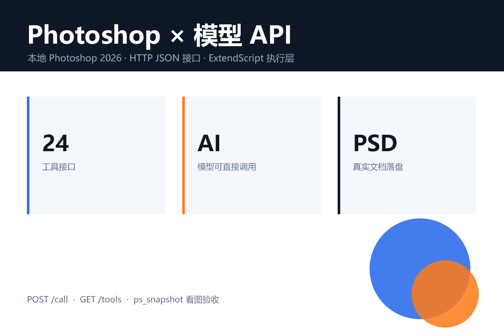
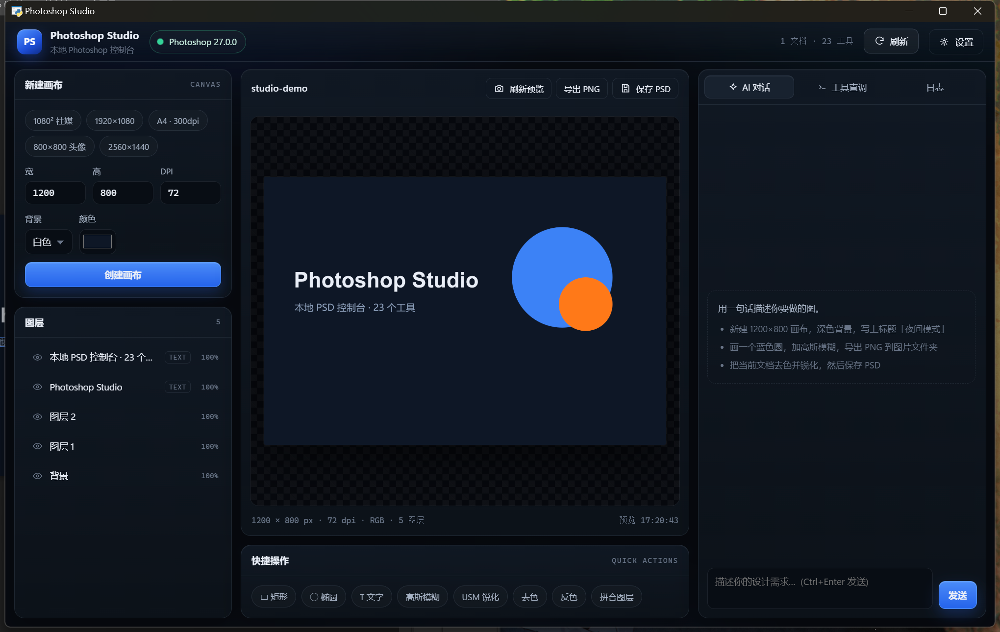
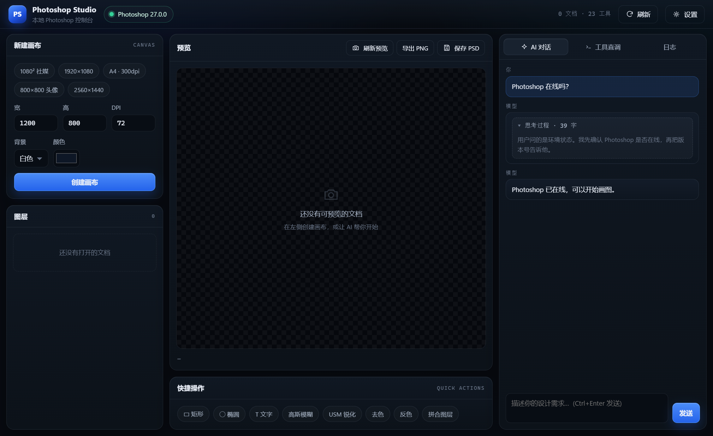

# Photoshop Studio —— 让模型接入本机 Photoshop

把本机 **Photoshop** 变成模型可调用的 **HTTP/JSON 接口**，并附带一个**双击即用的 Windows 桌面控制台**：
原生窗口 + 内置 WebView2，不经过浏览器、不需要命令行。

[English](#english) · [下载 exe](https://github.com/ASA00IS00ASA/photoshop-studio/releases) · [接口速查](#4-接口速查) · [MIT License](LICENSE)

## 快速开始

**想直接用**：到 [Releases](https://github.com/ASA00IS00ASA/photoshop-studio/releases) 下载 `PhotoshopStudio.exe`，双击运行
（本机需装有 Photoshop 2020+；Win10/11 自带 WebView2）。

**想改代码**：

```powershell
python -m pip install -r requirements.txt
python gui_app.py                     # 桌面版 GUI
python photoshop_api.py --selftest    # 只测 API：建文档 / 画图 / 打字 / 导出
```

一个单文件脚本把**本机 Photoshop** 包装成 **HTTP/JSON 接口**，任何模型（DeepSeek、GPT、Claude、Qwen…）
或者 Agent 框架只要会发 HTTP 请求，就能读写真实 PSD、画图层、打字、调色、导出图片。

```
[模型 / 客户端]
      │  HTTP JSON   POST /call   {"name": "ps_text", "arguments": {...}}
      ▼
[photoshop_api.py]  ← 串行 COM 工作线程
      │  Photoshop.Application.DoJavaScript()  (COM 自动化)
      ▼
[本机 Photoshop]  →  真实文档 / 图层 / 导出文件
```

* 通道：Photoshop 自带的 COM 自动化接口 + ExtendScript，**不需要装插件、不需要开远程调试端口**。
* 模型只做两件事：`GET /tools` 拿工具清单，`POST /call` 按名字调用。
* 已在 **Photoshop 2026 (27.0) / Windows** 上逐工具实测通过。

---

## 1. 环境要求

| 项目 | 说明 |
| --- | --- |
| 系统 | Windows（COM 自动化是 Windows 专有；macOS 需要换桥接层，见文末 FAQ） |
| Photoshop | 任意支持 COM 脚本的版本（2020+ 均可；实测 2026） |
| Python | 3.9+，需要 `pywin32`；`Pillow` 可选（用于把预览图缩小给视觉模型） |

```powershell
python -m pip install pywin32 Pillow
```

## 2. 启动

```powershell
cd photoshop-api
python photoshop_api.py --selftest     # ① 端到端自检：跑一遍建文档/画图/打字/导出，生成 selftest-preview.png
python photoshop_api.py                # ② 启动 API 服务，默认 http://127.0.0.1:8765
```

启动输出：

```
==============================================================
 Photoshop API 1.0.0   http://127.0.0.1:8765
   GET  http://127.0.0.1:8765/tools     模型工具清单
   POST http://127.0.0.1:8765/call      {"name", "arguments"}
   POST http://127.0.0.1:8765/jsx       原始 ExtendScript
   GET  http://127.0.0.1:8765/health    健康检查
   工具 23 个 | 工作目录 C:\...\photoshop-api
==============================================================
[warmup] 已连接 Photoshop 27.0.0（文档 0 个，0.1s）
```

第一次调用如果 Photoshop 没开，脚本会自动拉起它（约 10 秒），之后所有操作都在这个实例里进行；
如果你先手动打开了 Photoshop，脚本会直接接管那个实例。

自检产物 `selftest-preview.png` 就是下面这张（由 API 自己画出来的）：



## 3. GUI 桌面版（Windows 原生窗口，单文件 exe）

双击 `dist\PhotoshopStudio.exe` 即可：原生 WinForm 窗口 + 内置 WebView2 渲染 HTML/CSS 界面，
**不打开浏览器、不需要命令行**，同时把 API 服务（127.0.0.1 随机端口）跑在同一个进程里。

界面三栏：

| 区域 | 内容 |
| --- | --- |
| 左 | 新建画布（预设/宽高/DPI/背景色）、图层列表（点击选中、眼睛开关可见性） |
| 中 | 文档预览（自动刷新，透明区棋盘格）、导出 PNG / 保存 PSD、快捷操作（矩形/椭圆/文字/模糊/去色/反色/拼合） |
| 右 | AI 对话（自然语言驱动，需先在「设置」填模型 Base URL / API Key / 模型名）、工具直调（选工具 + JSON 参数）、日志 |



源码运行：`python gui_app.py`（`--mock` 只看界面，`--debug` 打开 WebView2 开发者工具）。

重新打包：

```powershell
powershell -ExecutionPolicy Bypass -File .\build.ps1
```

* 产物是单个 `dist\PhotoshopStudio.exe`（约 35 MB），拷到任何 Windows 10/11 机器双击即可（系统自带 WebView2）。
* 打包脚本会把 exe 的完整性级别设为 Medium：本工作区目录带 Low integrity 标签，不提升的话 PyInstaller onefile 自解压会报 “Could not create temporary directory”。
* 窗口默认 1360×860（逻辑像素），启动时会按当前显示器的**工作区**自动收窄并居中，150% 缩放或小屏也不会超出屏幕、不会压到任务栏。
* **只允许一个实例**：重复双击 exe 不会开出第二个窗口，而是把已经在跑的那个叫到前台。
* 关闭窗口即停止内置服务；服务只监听 `127.0.0.1` 的随机端口。
* 「设置」里的模型接口地址 / API Key 存在本机 WebView2 配置目录里，重启后不用重新填。
* 启动时如果 Photoshop 没开，程序会自动把它拉起来（约 10~20 秒）；连接完成后 Studio 窗口会自动回到前台。
* **思考过程折叠显示**：模型返回的 `reasoning_content` / `reasoning` / `thinking` 块会显示成「思考过程 · N 字」折叠块，默认收起，点开可看（最高 240px，可滚动），不挤占正文。



## 4. 接口速查

| 方法 | 路径 | 说明 |
| --- | --- | --- |
| GET | `/health` | 服务状态；`?connect=1` 主动连一次 Photoshop |
| GET | `/tools` | OpenAI function-calling 格式的工具清单（23 个） |
| POST | `/call` | 调用工具：`{"name": "...", "arguments": {...}}` |
| POST | `/jsx` | 直接执行 ExtendScript：`{"code": "..."}` 或纯文本 |

响应统一为：

```json
{"ok": true, "tool": "ps_doc_create", "result": {...}, "elapsed_ms": 242.0}
{"ok": false, "error": "找不到图层: xxx（JSX 第 87 行）"}
```

```bash
curl http://127.0.0.1:8765/health?connect=1
curl http://127.0.0.1:8765/tools
curl -X POST http://127.0.0.1:8765/call -H "Content-Type: application/json" ^
     -d "{\"name\":\"ps_doc_create\",\"arguments\":{\"width\":1200,\"height\":800,\"background\":\"white\"}}"
```

## 5. 工具清单（23 个）

| 工具 | 作用 | 关键参数 |
| --- | --- | --- |
| `ps_status` | Photoshop 版本 + 已打开文档列表 | – |
| `ps_doc_create` | 新建画布 | `width` `height` `resolution` `background`(white/transparent/color) `color` `name` |
| `ps_doc_open` | 打开图片/PSD | `path` |
| `ps_doc_info` | 文档信息（尺寸/模式/图层数/选区） | `index` |
| `ps_doc_save` | 保存/导出 `psd` `png` `jpg` `tif` | `path` `format` `quality` `as_copy` |
| `ps_doc_close` | 关闭文档 | `index` `save` |
| `ps_doc_resize_image` | 改像素尺寸（重采样） | `width` `height` `resolution` |
| `ps_doc_resize_canvas` | 改画布尺寸（裁切/扩展） | `width` `height` `anchor` |
| `ps_doc_flatten` | 拼合图层 | `index` |
| `ps_layers_list` | 图层树（组递归；含文字内容、边界、混合模式） | `index` |
| `ps_layer_add` | 新建图层（可整体填充颜色） | `name` `color` |
| `ps_layer_set` | 改名/不透明度/混合模式/可见性/设为当前层 | `name` `opacity` `blend` `visible` `new_name` |
| `ps_layer_delete` | 删除图层 | `name` / `layer_index` |
| `ps_layer_duplicate` | 复制图层 | `name` `new_name` |
| `ps_shape` | 画矩形 / 椭圆（纯色填充） | `shape` `x` `y` `width` `height` `color` `opacity` |
| `ps_text` | 添加文字（支持中文、多行 `\n`） | `content` `font` `size` `color` `x` `y` `align` |
| `ps_fill` | 纯色填充整层或选区 | `color` `name` `whole_layer` |
| `ps_select` | 全选 / 取消 / 矩形选区 | `mode` `x` `y` `width` `height` |
| `ps_adjust` | 亮度对比度 / 色相饱和度 / 去色 / 反相 / 色阶 / 自动色阶 / 自动对比度 / 色调分离 / 阈值 | `kind` + 对应数值 |
| `ps_filter` | 高斯模糊 / 动感模糊 / USM 锐化 | `kind` `radius` `angle` `amount` |
| `ps_image_place` | 把磁盘图片作为图层置入，可定位缩放 | `path` `x` `y` `width` `height` |
| `ps_snapshot` | 导出预览图，返回路径 + base64（给视觉模型看图） | `max_size` `return_base64` `path` |
| `ps_jsx` | 执行任意 ExtendScript（逃生舱） | `code` |

坐标单位统一是**文档像素**，原点左上角；`ps_text` 的 `x/y` 是文字**基线**左端点（和 Photoshop 脚本一致）。

## 6. 让模型接进来

### 方式 A：OpenAI / DeepSeek 等 function calling（现成示例）

```powershell
# 另开一个终端
$env:OPENAI_BASE_URL="https://api.deepseek.com/v1"   # 或 https://api.openai.com/v1
$env:OPENAI_API_KEY="sk-xxxxxxxx"
$env:OPENAI_MODEL="deepseek-chat"                    # 或 gpt-4o-mini 等

python model_client_example.py --check               # 先确认 API 通
python model_client_example.py "新建 1200x800 白色画布，画一个蓝色圆和橙色矩形，标题写'海报'，导出到 D:\out\poster.png"
```

它会自动：`GET /tools` → 把工具塞进 `tools` 字段 → 循环执行 `tool_calls` → `POST /call` → 把结果回喂模型，直到模型给出最终答复。
核心就三十行，见 `model_client_example.py`，可以照抄进你自己的 Agent。

### 方式 B：任何 Agent 框架 / 自研循环

1. `GET http://127.0.0.1:8765/tools` 拿到 OpenAI 格式的 `tools`，直接作为工具定义；
2. 模型要调用时，`POST /call`，body 是 `{"name": "<工具名>", "arguments": {...}}`；
3. 把返回的 `result` JSON 作为工具结果塞回上下文。

LangChain / LlamaIndex / Dify / n8n / Coze 都可以走这个 HTTP 接口，不需要额外 SDK。

### 让模型「看见」自己的作品

`ps_snapshot` 会导出 PNG 并返回 `image_base64` / `data_url`，把它转成视觉模型的图片消息即可让模型自查：

```python
snap = call("ps_snapshot", {"max_size": 1024})
img = {"type": "image_url", "image_url": {"url": snap["data_url"]}}
```

### 思考过程与 Anthropic 内容块

GUI 的 `/llm/chat` 代理不挑上游协议，两种返回都能接：

* **OpenAI 兼容**（DeepSeek / GPT / vLLM…）：从 `choices[0].message` 读；`reasoning_content`、`reasoning`，以及 content 数组里的 `reasoning` 块都会抽成 `message.reasoning`，正文仍是 `message.content`，工具调用仍是 `message.tool_calls`。
* **Anthropic 风格**：直接返回 `{content: [{type:"thinking"}, {type:"text"}, {type:"tool_use"}]}` 也认——`thinking` → `reasoning`，`text` → `content`，`tool_use` → `tool_calls`（`input` 自动转成 JSON 字符串）。

界面回传历史时如果是 Anthropic 内容块数组，会先转成 OpenAI 能吃的形状：

| Anthropic 块 | 转换结果 |
| --- | --- |
| `text` / `output_text` / `input_text` | 合并进字符串 `content` |
| `image`（base64） | `image_url` data URI |
| `tool_use` | assistant 消息的 `tool_calls` |
| `tool_result` | 单独的 `role: "tool"` 消息（带 `tool_call_id`） |

`reasoning` / `thinking` 只在界面上展示（折叠块），**不会回传给上游**——DeepSeek 等服务端收到这些字段会直接 400。

## 7. `/jsx`：做不到的就写脚本

23 个工具覆盖常见操作；遇到没有封装的能力（曲线、液化、动作、批处理、智能对象…），直接发 ExtendScript：

```bash
curl -X POST http://127.0.0.1:8765/jsx -H "Content-Type: application/json" ^
  -d "{\"code\": \"var d = app.activeDocument; d.activeLayer.applyGaussianBlur(8); 'ok';\"}"
```

`/jsx` 的返回值是最后一条表达式的字符串；`app`、`app.activeDocument`、`charIDToTypeID` 等都可直接用。
想把它变成正式工具，参考下一节。

## 8. 扩展：加一个自己的工具

在 `photoshop_api.py` 里照抄一个 `@tool`，参数用 `P()` 声明，主体是 ExtendScript（`__r = ...` 就是返回值）：

```python
@tool("ps_tint", "给当前图层叠加指定颜色（正片叠底）",
      {"color": P("string", "颜色 #RRGGBB"), "index": P("integer", "文档序号")}, ["color"])
def h_tint(a):
    body = """
var o = $ARGS;
var d = __doc(o.index);
var l = d.artLayers.add();
l.name = "tint";
d.selection.selectAll();
d.selection.fill(__color(o.color), ColorBlendMode.NORMAL, 100, false);
d.selection.deselect();
l.blendMode = BlendMode.MULTIPLY;
__r = __layerJson(l);
"""
    return run_jsx(render(body, a))
```

重启服务后它会自动出现在 `/tools` 里，模型立刻可用。

## 9. 设计说明

* **单 COM 线程串行执行**：所有 Photoshop 调用排进一个工作线程，避免多线程 COM 冲突；HTTP 层是并发的，但落到 Photoshop 是顺序的（Photoshop 本身也只能单线程处理文档）。
* **禁止弹窗**：连接时设置 `displayDialogs = NO`、`rulerUnits = PIXELS`，避免「另存为」之类对话框卡住自动化。
* **错误可读**：异常/JSX 报错统一转成 `{"ok": false, "error": "..."}` 并带上 JSX 行号；连接断了会自动重连一次。
* **参数校验**：缺少必填参数会在 Python 侧直接返回 `缺少必填参数: width`，而不是让 Photoshop 抛通用错误。
* **中文安全**：参数以 `ensure_ascii` 的 JSON 字面量注入 ExtendScript，避免 COM 传输编码问题；ExtendScript 没有 `JSON` 对象，脚本自带序列化器。
* **路径**：相对路径按服务进程的工作目录解析（启动时打印），保存时会自动建目录。
* **安全**：默认只监听 `127.0.0.1`；需要跨机器访问时用 `--host 0.0.0.0 --token <随机串>`，请求带 `Authorization: Bearer <token>`。

## 10. 常见问题

| 现象 | 处理 |
| --- | --- |
| `缺少 pywin32` | `python -m pip install pywin32` |
| `80040154 class not registered` / 连不上 | 先手动打开一次 Photoshop（让它完成注册/登录），再启动服务；或确认安装的是完整版而非绿色精简版 |
| 第一次调用卡十几秒 | 正常，正在启动 Photoshop；之后每次调用 100–800ms |
| `指定值大于最大允许值` | 常见于 JPEG 质量等有范围限制的参数，脚本已把 0–100 映射到 PS 的 0–12 档 |
| 大图/滤镜超时 | 调大工具 `timeout`（`ps_jsx` 支持 `timeout` 参数），或先 `ps_doc_resize_image` 缩小 |
| 端口被占用 | `python photoshop_api.py --port 8766` |
| GUI 双击没反应 / 一闪而过 | 打开 `%LOCALAPPDATA%\Photoshop Studio\studio.log` 看最后几行；常见原因是缺 WebView2 Runtime 或 pywin32 没装 |
| GUI 窗口白屏 | 同上；确认系统有 WebView2 Runtime（Win10/11 一般自带，缺失时装 Evergreen Runtime），再双击 exe |
| GUI 提示「已有实例在运行」 | 单实例保护：只是把已经打开的那个窗口切到前台，不是报错 |
| GUI 里 AI 对话报「未配置 API Key」 | 右上角「设置」填模型 Base URL（如 `https://api.deepseek.com/v1`）、API Key、模型名（如 `deepseek-chat`） |
| macOS | COM 不可用。HTTP/工具定义可复用，需要把 `PSBridge.call_jsx()` 换成 AppleScript `do javascript`（Photoshop 26.4+ 原生支持）或 ExtendScript Toolkit 桥 |
| 模型把画布画错位置 | 用 `ps_doc_info` 先确认尺寸，坐标是文档像素、原点左上角 |

## 11. 文件

```
photoshop-api/
├── gui_app.py                # 桌面入口：内置 HTTP 服务 + WebView2 窗口 + 模型代理 + 静态资源
├── gui/web/                  # 界面：index.html / app.css / app.js（纯 CSS + 原生 JS，离线）
├── photoshop_api.py          # 核心：COM 桥 + 23 个工具 + HTTP API（单文件）
├── model_client_example.py   # 用 OpenAI 兼容模型（function calling）驱动 Photoshop 的示例
├── build.ps1                 # 一键打包 exe（PyInstaller onefile + windowed）
├── tools/make_icon.py        # 生成 assets/studio.ico
├── assets/studio.ico
├── requirements.txt          # pywin32 + Pillow + pywebview
├── screenshot.png            # GUI 界面截图
├── LICENSE                   # MIT
├── .gitignore
├── README.md
├── dist/                     # 本地打包产物（不入库，成品见 Releases）
└── selftest-preview.png      # python photoshop_api.py --selftest 的产物
```

## English

**Photoshop Studio** exposes a local Adobe Photoshop installation as a JSON-over-HTTP tool API
(COM + ExtendScript; no plugin, no debug port), and ships a double-clickable Windows desktop console
(native window + embedded WebView2, no browser required).

* `GET /tools` returns OpenAI function-calling tool definitions; `POST /call` runs one by name.
* 23 tools: documents, layers, shapes, text (CJK-safe), fills, selections, adjustments, filters,
  image placement, vision-friendly PNG snapshots, and a raw `ps_jsx` escape hatch.
* `ps_snapshot` returns a base64 PNG so vision models can inspect their own work.
* GUI: canvas presets, live preview, layer tree, PNG/PSD export, natural-language panel
  (any OpenAI-compatible endpoint), tool runner and logs.

Requirements: Windows 10/11, Photoshop 2020+, Python 3.9+ with `pywin32` / `Pillow` / `pywebview`
(only when running from source).

Quick start: grab `PhotoshopStudio.exe` from [Releases](https://github.com/ASA00IS00ASA/photoshop-studio/releases),
or `pip install -r requirements.txt && python gui_app.py`.

Not affiliated with Adobe. Tested with Photoshop 2026 (27.0) on Windows 11.

## License

MIT — see [LICENSE](LICENSE).
